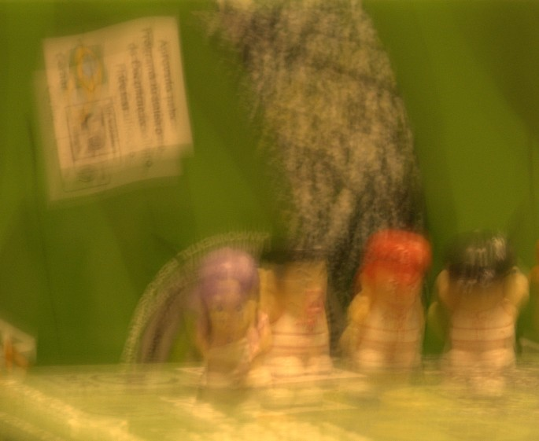
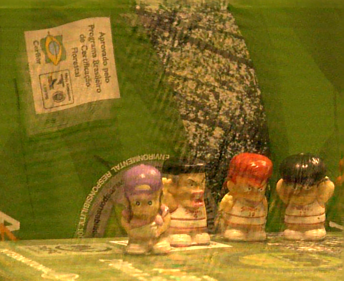
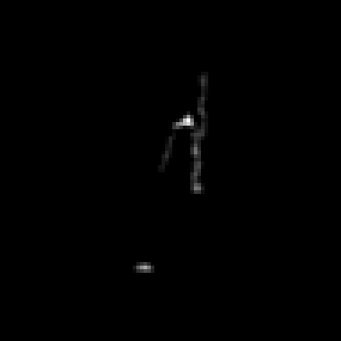

# Two-Phase Kernel Estimation for Robust Motion Deblurring

An unofficial Python/NumPy implementation of [Two-Phase Kernel Estimation for Robust Motion Deblurring](https://doi.org/10.1007/978-3-642-15549-9_12) (Xu & Jia, ECCV 2010) — blind motion deblurring of a single image, written from scratch with OpenCV/SciPy (no deep learning).

## What's Implemented

**Phase 1 — coarse-to-fine kernel estimation** (√2-step image pyramid):

- Edge prediction by Gaussian smoothing + an upwind Osher–Rudin shock filter on the current latent estimate
- Gradient-confidence map `r` (Eq. 1) and informative-edge selection with per-orientation thresholds (`tau_r`, `tau_s`), gradually relaxed (`/1.1`) each iteration so more edges join as the kernel improves
- Kernel estimation from the selected edge gradients with Tikhonov regularization, solved exactly on the kernel support with preconditioned conjugate gradients (the normal equations reduce to a tiny convolution with the edge auto-correlation, so each solve costs two FFTs), then projected to a valid kernel (non-negative, small values and isolated blobs removed, sum to 1)
- Closed-form FFT latent-image update with the edge-guided gradient prior (Eq. 5)

**Phase 2 — kernel refinement and final deconvolution**:

- ISD kernel refinement: iterative support detection with IRLS-weighted ℓ1 outside the detected support, fitted against the gradients of the phase-one latent image
- Fast TV-ℓ1 deconvolution via half-quadratic splitting, run on every colour channel

**Boundary handling**: all FFT work happens on a canvas that is periodically extended with smoothly blended borders, and in the final deconvolution the padded pixels carry no data term, so the unknown content outside the frame does not force ringing into the result.

## Run

```bash
pip install opencv-python numpy scipy scikit-image
python main.py
```

Runs on the bundled `toy.jpg` at full resolution with a 95×95 kernel (≈16 s on 4 CPU cores) and writes `restored.png` and `kernel.png`. Useful options:

```bash
python main.py --input my.jpg --ksize 61 --scale 0.5 --output out.png --show
```

`--ksize` should be somewhat larger than the blur trail (≈1–1.5×); far too large a kernel (e.g. 121 for `toy.jpg`) makes the coarse levels unstable.

## Results

| Blurred input | Restored latent image | Estimated kernel |
|---|---|---|
|  |  |  |

### Synthetic benchmark

`python benchmark.py` blurs four `skimage.data` images with known, randomly generated camera-shake kernels (plus σ = 0.005 noise), runs the full pipeline and reports shift-aligned PSNR/SSIM and kernel similarity (max normalized cross-correlation with the ground truth kernel, 1 = perfect):

| image | blurred | previous implementation | this implementation | kernel sim (prev → now) |
|---|---|---|---|---|
| camera    | 19.89 dB / 0.568 | 14.38 dB / 0.154 | **29.39 dB / 0.831** | 0.39 → 0.93 |
| coffee    | 21.33 dB / 0.591 |  6.98 dB / 0.013 | **27.81 dB / 0.827** | 0.31 → 0.96 |
| astronaut | 19.88 dB / 0.580 | 16.80 dB / 0.340 | **27.51 dB / 0.880** | 0.37 → 0.91 |
| chelsea   | 23.92 dB / 0.563 | 19.38 dB / 0.345 | **29.69 dB / 0.849** | 0.34 → 0.90 |

With the ground-truth kernel the same TV-ℓ1 step reaches 30.8 dB on average, so the remaining gap to non-blind deconvolution is ≈2.2 dB.

## Fixes over the previous version

- **Final deconvolution had no regularizer**: the TV term was multiplied by `0`, turning the update into a plain inverse filter `F(B+v)/F(k)` that amplifies noise at the kernel's spectral zeros — the main source of the stripe artifacts. The correct `β/θ` weight is now used.
- **Shock filter was a no-op**: `dt = 0.25/255` moves edges by ~0.001 px per step (the shock PDE is intensity-scale invariant), so no sharp edges were ever predicted.
- **Orientation groups were wrong**: two of the four angle masks used `|` instead of `&`, so they contained almost every pixel; `tau_s` also ranked signed gradient components instead of `M·‖∇Ĩ‖`.
- **Phase 2 estimated a flipped kernel**: the `im2col` system computes correlation, not convolution, so the least-squares solution was the kernel rotated by 180°. Its IRLS weight was also the scalar `sum(|k|) = 1` (an L2 penalty, not reweighted ℓ1), it had no iteration limit and built a dense `AᵀA` (~10¹¹ flops).
- **Edge selection degenerated**: 100 iterations per level with `τ /= 1.1` shrank the thresholds by 1.1¹⁰⁰ ≈ 14 000×, so every noisy gradient was eventually used to estimate the kernel. Now 20 iterations per level.
- **Zero padding at the borders** created a hard step in the circular blur model; replaced by the smooth periodic extension and masked data term described above.
- Kernel solved on its support instead of cropping an unconstrained FFT solution; kernel centred between pyramid levels; removed `np.bool`/`np.float` (they crash on NumPy ≥ 1.24); headless by default (`--show` for windows); ~14× faster (133 s → 9.6 s on the 512×512 benchmark image).

## Known Issues

- The kernel is estimated on a gamma-encoded image; saturated highlights and strong JPEG artifacts can still produce mild ringing.
- Kernel size is a user choice; a kernel far larger than the true blur can make the coarse-to-fine estimation fail.

## Reference

```bibtex
@inproceedings{xu2010two,
  title={Two-Phase Kernel Estimation for Robust Motion Deblurring},
  author={Xu, Li and Jia, Jiaya},
  booktitle={European Conference on Computer Vision (ECCV)},
  pages={157--170},
  year={2010},
  organization={Springer}
}
```
